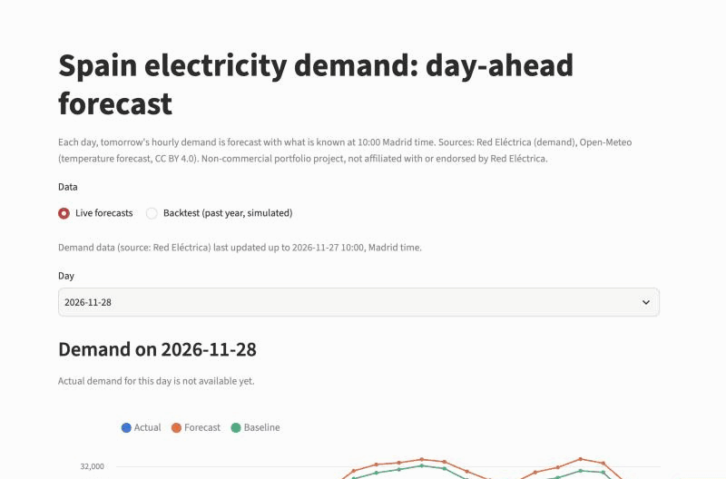

# Energy Demand Forecast

Day-ahead forecast of Spain's hourly electricity demand, evaluated against simple baselines.

**Status:** a [daily pipeline](docs/pipeline.md) records tomorrow's forecast in
`data/predictions.csv`. The API runs locally.

**Live dashboard:** <https://energy-demand-forecast-pz2daz6h6ksbmcszecf7nl.streamlit.app/> (free hosting: if it is asleep, it takes a while to wake up). Backtest over 2025-09 to 2026-08:



| Model | MAPE |
|---|---|
| Baseline (same hour one week earlier) | 4.16% |
| Linear regression per hour | 3.07% |
| Gradient boosting | 2.55% |
| Gradient boosting on the weekly change | 2.51% |

On the [held-out test](docs/final_test.md) (2026-09-01 to 2026-11-25, run once) the chosen model had
**2.70% MAPE**, against 4.94% for the baseline.

See [Evaluation](docs/evaluation.md) and [Model notes](docs/models.md).

- [Plan](docs/PLAN.md)
- [Data notes](docs/DATA.md)

```bash
python3.12 -m venv .venv
.venv/bin/pip install -r requirements-dev.txt
.venv/bin/pytest
```

## Dashboard

```bash
.venv/bin/streamlit run app.py
```

Forecast against actual demand for any day, and the error history, for live forecasts or the backtest.

## API

```bash
PYTHONPATH=src .venv/bin/uvicorn api.main:app
```

`GET /forecast` returns the latest recorded forecast, `GET /forecast?day=2026-11-28` a given day.
Interactive documentation is at `/docs`.

## Backtest

```bash
PYTHONPATH=src .venv/bin/python -m forecast.evaluate
```

## Data

```bash
PYTHONPATH=src .venv/bin/python -m forecast.ingest
```

Writes two hourly tables indexed in UTC, and on later runs downloads only recent days:

| File | Column | Source |
|---|---|---|
| `data/demand.parquet` | `demand_mw` | [Red Eléctrica](https://www.ree.es/en/datos/apidata), REData API |
| `data/temperature.parquet` | `temperature_c` | [Open-Meteo](https://open-meteo.com/) (CC BY 4.0), two-day-ahead forecast, population-weighted |

A missing hour is stored as an empty value. Nothing is interpolated.

### Data credits and licence

- Demand data: **source Red Eléctrica**. Hourly values are averages computed here from the published
  5-minute values. The data snapshot is refreshed on the 1st of each month and `data/predictions.csv`
  daily; the last timestamp in each file shows how recent it is, and the dashboard displays it. The
  first snapshot was taken on 2026-11-26.
- Temperature: [Open-Meteo](https://open-meteo.com/), CC BY 4.0, combined here into a weighted average.
- This is a non-commercial portfolio project, not affiliated with or endorsed by Red Eléctrica. Their
  [legal notice](https://www.ree.es/es/aviso-legal) applies to their content.
- The MIT licence of this repository covers the **code only**, not the data in `data/`.
